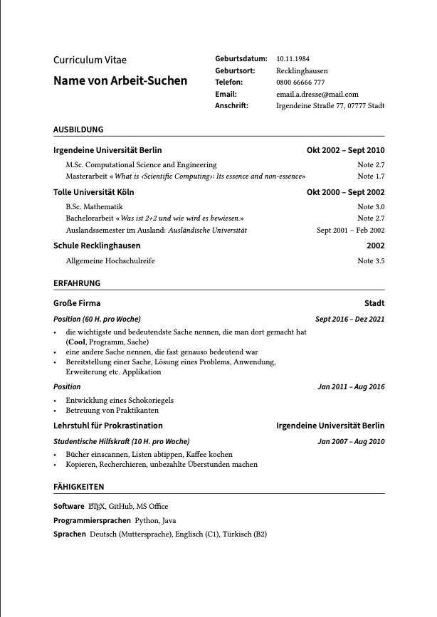

# Rover Resume (deutsch)

Deutsche Anpassung der Vorlage **Base Rover** aus [Rover Resume](https://github.com/subidit/rover-resume) von subidit.

## Vorschau

<p align="center">
  <kbd>
    
  </kbd>
</p>

## Änderungen gegenüber dem Original

### Kopfbereich: bündige Ausrichtung

Im Original stehen Name und Titel links und die Kontaktdaten rechts in zwei getrennten `minipage`-Blöcken. Das ist klar, kompakt und einfach, aber die beiden Blöcke haben keine gemeinsame Linie, sie sind nur zueinander zentriert.

Hier ist der Kopf eine Tabelle, und die Schriftgrößen sind bewusst unterschiedlich. Trotzdem schließen die Zeilen an zwei Stellen bündig ab:

1. **Oberkante:** "Curriculum Vitae" ist größer gesetzt als "Geburtsdatum:", aber die Versalien (`C` und `G`) beginnen auf derselben Höhe.
2. **Grundlinie:** Der Name ist deutlich größer als "Telefon:", aber beide stehen auf derselben Grundlinie.

```
Curriculum Vitae          Geburtsdatum:   10.11.1984        <- gleiche Oberkante
                          Geburtsort:     Recklinghausen
Name von Arbeit-Suchen    Telefon:        0800 66666 777    <- gleiche Grundlinie
                          Email:          email.a.dresse@mail.com
                          Anschrift:      Irgendeine Straße 77, 07777 Stadt
```

Die Schriftgrößen sind ungleich, die Linien sind gleich. Das gleicht aus, was am Original fehlt, ohne dessen Einfachheit aufzugeben.

### Code

```latex
\renewcommand{\arraystretch}{1.18}
\begin{tabularx}{\textwidth}{@{} p{6.8cm} >{\sffamily\sbseries}l >{\raggedright\arraybackslash}X @{}}

	\raisebox{\dimexpr\capB-\capA\relax}{\cvfont Curriculum Vitae} & Geburtsdatum: & 10.11.1984 \\
	 & Geburtsort: & Recklinghausen \\
	\smash{\LARGE\sffamily\sbseries Name von Arbeit-Suchen} & Telefon: & 0800 66666 777 \\
	 & Email: & email.a.dresse@mail.com \\
	 & Anschrift: & Irgendeine Straße 77, 07777 Stadt
\end{tabularx}
```

### Grundlinie: Name und Telefon

In einer Tabellenzeile sitzen alle Zellen standardmäßig auf einer gemeinsamen Grundlinie. Für Name und Telefon ist das genau gewünscht, es muss also nichts verschoben werden. Das Problem ist die Zeilenhöhe: Der große Name würde die dritte Zeile höher machen als die anderen, und der gleichmäßige Zeilenabstand wäre weg.

`\smash{...}` setzt Höhe und Tiefe des Namens auf null. Die Tabelle rechnet dann mit normaler Zeilenhöhe, der Name ragt nach oben in die leere Zelle der Zeile darüber. Seine Grundlinie bleibt dabei unverändert und liegt auf der von "Telefon:".

### Oberkante: Titel und Geburtsdatum

Hier ist die Standardausrichtung das Problem: Läge die Grundlinie von "Curriculum Vitae" auf der von "Geburtsdatum:", würde der größere Titel oben herausragen. Die Oberkanten sollen aber bündig sein, also muss der Titel nach unten.

```latex
\newcommand{\cvfont}{\Large\sffamily}
\newlength{\capA}\newlength{\capB}
\settoheight{\capA}{\cvfont H}
\settoheight{\capB}{\normalsize\sffamily\sbseries H}
```

- `\settoheight` misst die Höhe eines Großbuchstabens (`H`) in beiden Schriften: `\capA` für den Titel, `\capB` für die Beschriftung.
- `\capA` ist größer als `\capB`. Die Differenz `\capB-\capA` ist negativ.
- `\raisebox{\dimexpr\capB-\capA\relax}{...}` hebt den Titel um diese negative Differenz an, senkt ihn also um genau den Höhenunterschied der Versalien. Danach liegen die Oberkanten beider Wörter auf einer Linie. `\dimexpr` rechnet mit den Längen, `\relax` beendet den Ausdruck.

Weil die Höhen gemessen werden, funktioniert die Ausrichtung auch, wenn Schriftart oder Größe geändert werden. Es muss kein Wert von Hand nachjustiert werden.

### Spalten

```latex
{@{} p{6.8cm} >{\sffamily\sbseries}l >{\raggedright\arraybackslash}X @{}}
```

- **`@{}` am Anfang und Ende:** entfernt den Standardabstand links und rechts, damit die Tabelle bündig mit dem Text abschließt.
- **`p{6.8cm}`:** feste Breite für Titel und Name.
- **`>{\sffamily\sbseries}l`:** schmale, linksbündige Spalte für die Bezeichnungen. `>{...}` setzt vor jeden Eintrag der Spalte die Schrift (Sans, Semibold), sodass nicht jede Zelle einzeln formatiert werden muss.
- **`>{\raggedright\arraybackslash}X`:** nimmt die restliche Breite. `\raggedright` verhindert Blocksatz und große Wortabstände. `\arraybackslash` stellt die Bedeutung von `\\` als Zeilenende der Tabelle wieder her, sonst gibt es Fehlermeldungen.
- **`\arraystretch` 1.18:** vergrößert die Zeilenhöhe um 18 %.

### Anpassen

- **Zeile hinzufügen:** `& Bezeichnung: & Wert \\` einfügen, die erste Zelle bleibt leer.
- **Linken Block verbreitern:** Wert in `p{6.8cm}` ändern. Ein sehr langer Name läuft wegen `\smash` nicht um, sondern über die Spaltenbreite hinaus. Dann `\LARGE` zu `\Large` ändern oder die Spalte verbreitern.
- **Zeilenabstand:** `1.18` in `\arraystretch` ändern.

### Hyperlinks

Das Original verzichtet bewusst auf `hyperref`. Hier ist es eingebunden, damit Namen von Universitäten und Arbeitgebern direkt auf deren Webseiten verlinken (`\href`). Mit `hidelinks` bleiben die Links klickbar, werden aber ohne farbige Rahmen oder Schrift dargestellt, das Druckbild bleibt unverändert. `xurl` erlaubt Umbrüche an beliebiger Stelle in Links und E-Mail-Adressen, sodass nichts über den Rand läuft. Außerdem sind Titel und Autor in den PDF-Metadaten gesetzt.

### Schrift

Das Original nutzt die LaTeX-Standardschrift (Computer Modern). Hier werden zwei Schriften kombiniert:

- **Linux Libertine** für den Fließtext (Serif). Sie wurde für gedruckten Text entworfen und bleibt auch bei 11 pt gut lesbar. Sie steht unter einer freien Lizenz, bringt einen sehr umfangreichen Zeichensatz mit (Umlaute, ß, Ligaturen, Kapitälchen, Mediävalziffern) und liegt jeder TeX-Live-Installation und Overleaf bei.
- **Source Sans** für Überschriften und Beschriftungen (Sans Serif). Sie ist ebenfalls frei und klar gezeichnet und hat eine Semibold-Stufe, die für die Überschriften genutzt wird.

Die Mischung aus Serif und Sans Serif schafft Orientierung: Überschriften und Bezeichnungen heben sich vom Text ab, ohne dass das Layout altbacken wirkt. Als Alternative zu Source Sans ist `cabin` vorbereitet.

### Überschriften und Abstände

Überschriften sind in Semibold-Sans gesetzt, Abschnitte in Großbuchstaben mit Trennlinie. Die Abstände werden nicht mehr auf null gesetzt (`*0`), sondern für jede Ebene explizit festgelegt, damit der Text nicht gedrängt wirkt.

### Deutsche Sprache

`babel` mit `ngerman` sorgt für deutsche Silbentrennung und Bezeichnungen, `fontenc` (T1) und `inputenc` (utf8) für Umlaute und ß.

### Präambel

Schriften:

```latex
\usepackage[T1]{fontenc}
\usepackage[utf8]{inputenc}
\usepackage[ngerman]{babel}

\usepackage{libertine}      % Serif für den Fließtext
\usepackage{sourcesanspro}  % Sans Serif für Überschriften
% Alternative: \usepackage{cabin} statt sourcesanspro

\DeclareRobustCommand{\sbseries}{\fontseries{sb}\selectfont}
\DeclareTextFontCommand{\textsb}{\sbseries}
```

`\sbseries` schaltet auf die Semibold-Stufe, `\textsb{...}` ist die Variante für einzelne Textstellen.

Überschriften und Abstände:

```latex
\titleformat{\section}
  {\large\sffamily\sbseries\uppercase}{}{0pt}{}[\vspace{1.3pt}\titlerule]
\titleformat{\subsection}
  {\large\sffamily\sbseries}{}{0pt}{}
\titleformat{\subsubsection}
  {\normalsize\sffamily\sbseries\itshape}{}{0pt}{}

\setlength{\parskip}{0.2em}
\titlespacing{\section}{0pt}{15pt}{10pt}
\titlespacing{\subsection}{0pt}{6pt}{4pt}
\titlespacing{\subsubsection}{0pt}{2pt}{2pt}
```

`\titlespacing` nimmt die Werte `{links}{vor der Überschrift}{nach der Überschrift}`. Die Abstände lassen sich dort einzeln anpassen, ohne `\vspace` im Text zu verwenden.

Links:

```latex
\usepackage[hidelinks, bookmarks=false,
            pdftitle={Curriculum Vitae},
            pdfauthor={Name von Arbeit-Suchen}]{hyperref}
\usepackage{xurl}
```

Kopfbereich:

```latex
\newcommand{\cvfont}{\Large\sffamily}

\newlength{\capA}\newlength{\capB}
\settoheight{\capA}{\cvfont H}
\settoheight{\capB}{\normalsize\sffamily\sbseries H}
```

`\capA` und `\capB` messen die Höhe eines Großbuchstabens in der großen Titelschrift und in der normalen Beschriftungsschrift. Mit `\raisebox{\dimexpr\capB-\capA\relax}` wird "Curriculum Vitae" um die Differenz verschoben, sodass die Oberkanten der Großbuchstaben in der ersten Zeile bündig mit dem Rest der Tabelle stehen. Der Name in der dritten Zeile ist mit `\smash` gesetzt, damit die große Schrift die Zeilenhöhe nicht aufbläht.

## Quelle und Lizenz

Basiert auf der Vorlage **Base Rover** aus [Rover Resume](https://github.com/subidit/rover-resume) von subidit. Lizenz siehe [LICENSE](LICENSE).
